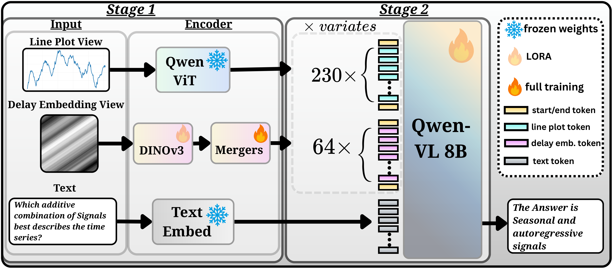
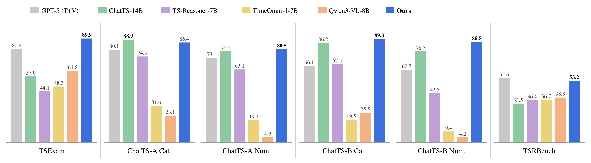

# Twice Upon a Time: Complementary Representations for Time-Series Reasoning

<p align="center">
<a href="https://arxiv.org/abs/2610.22327"></a>
<a href="https://huggingface.co/SequentialLearning/DualTime-8B"></a>
<a href="https://huggingface.co/datasets/SequentialLearning/DualTime-data"></a>
</p>

Time Series Language Models (TSLMs) enable language-based understanding and
reasoning over temporal data, yet a fundamental question remains: what
information should their time-series representations preserve, and what
variation should they factor out? Existing TSLMs typically expose the language
model to a single representation, imposing a fixed inductive bias across
downstream tasks. We instead introduce complementary representations as a
design principle for time-series reasoning. Our model combines two visual
views: line plots preserve absolute measurements and the observed coordinate
frame, while normalized delay embeddings factor out positive amplitude
rescaling and offsets while exposing temporal structure. Dedicated visual
encoders integrate both views into a shared language model through visual
tokens and multi-level feature fusion. Evaluation-time interventions verify
that the two views exhibit distinct invariance profiles, while single-view
ablations show that their combination is particularly beneficial beyond basic
perception, with the large gains in prediction and reasoning. Built on
Qwen3-VL-8B, our dual-view model improves overall TSRBench accuracy from 44.5%
with line plots alone to 53.2%, substantially exceeding the strongest evaluated
dedicated TSLM baseline at 36.7%. It further achieves 89.9% accuracy on TSExam
and 86.8% numerical accuracy on multivariate ChatTS alignment. Together, these
results demonstrate that complementary representations provide an effective
design principle for general-purpose TSLMs, enabling models to exploit temporal
structure without sacrificing access to the original measurement frame.



Model overview. Each series is rendered as a line plot (read by the frozen
Qwen ViT) and as a normalized delay-embedding image (read by DINOv3 through
trained mergers); both token streams and the text enter Qwen3-VL-8B. Stage 1
trains the DINOv3 LoRA and the mergers, Stage 2 the language-model LoRA.



Cross-benchmark accuracy (%). ChatTS-A and ChatTS-B report categorical (Cat.)
and numerical (Num.) alignment on the univariate and multivariate datasets,
respectively. Bold marks the best result in each panel, excluding GPT-5 (T+V),
shown in gray, which is a large proprietary model included as a reference
rather than a size-matched comparison.

## Setup

### 1. Clone

```bash
git clone https://github.com/azencot-group/dual-time.git && cd dual-time
```

### 2. Environment

Python 3.11, torch 2.7.0 (CUDA 12.8), `requirements.txt`, flash-attn 2.8.3:

```bash
python3.11 -m venv .venv && source .venv/bin/activate      # or: uv venv --python 3.11 .venv
pip install --extra-index-url https://download.pytorch.org/whl/cu128 torch==2.7.0 torchvision==0.22.0
pip install -r requirements.txt
pip install flash-attn==2.8.3 --no-build-isolation          # builds from source (~30 min, needs nvcc);
                                                           # prebuilt wheels: github.com/Dao-AILab/flash-attention/releases
python scripts/check_env.py                                # CUDA, bf16, flash-attn, versions (--skip-model before the base model is downloaded)
```

Without flash-attn train with `--attn sdpa`. The venv above is all that is
needed; Docker is optional (`bash docker/build.sh` builds the same environment
into an image, `bash docker/run.sh [--artifacts DIR] [-- cmd]` runs it).

Everything heavy lives under the repository (gitignored) and is created by the
scripts; the Hugging Face cache (`HF_HOME`) holds DINOv3, ChatTS, CaTS-Bench
and TimeSeriesExam:

```
artifacts/
  models/Qwen3-VL-8B-Instruct/   base model
  checkpoints/                   training outputs, released adapters (DualTime-8B/)
data/stageA/, data/stageB/       training corpora
eval_data/tsrbench/, chatts_eval/  benchmark data
results/<label>/                 evaluation outputs
logs/                            launcher logs
```

### 3. Models and data

Every run (training or evaluation) needs the base model and the second tower:

```bash
hf download Qwen/Qwen3-VL-8B-Instruct --local-dir artifacts/models/Qwen3-VL-8B-Instruct   # 17 GB
hf download facebook/dinov3-vitl16-pretrain-lvd1689m                                       # 1.2 GB, HF cache
```

The DINOv3 repository is gated: accept Meta's DINOv3 licence on its Hub page
once and `hf auth login` before downloading.

For training, three sources come from their own repositories and the five
in-house corpora from the Hub dataset `SequentialLearning/DualTime-data`:

```bash
# Stage A: CaTS-Bench captions (HF cache)
hf download mhfisher/CaTSBench --repo-type dataset
# Stage B: ChatTS ift + sft instruction sets (HF cache)
hf download ChatTSRepo/ChatTS-Training-Dataset --repo-type dataset --include "ift/*" --include "sft/*"
# Stage A + B: ChatTS-style captions, structural captions, TSExam perception,
# numerical corpus, reasoning corpus -> data/stageA, data/stageB
hf download SequentialLearning/DualTime-data --repo-type dataset --local-dir data
```

`bash scripts/download_assets.sh` runs all of the above, plus the benchmark
downloads of the evaluation section, in one go (`--models-dir`, `--data-dir`,
`--eval-dir` relocate the targets; `--skip-base` skips the 17 GB base model).

`data/README.md` describes the tree. Charts and delay images are rendered at training time; nothing is
pre-rendered.

## Training

```bash
python scripts/train.py --stage A   # configs/stageA_dual8b.yaml -> artifacts/checkpoints/stageA_dual8b/best         (~2 h on 2x B200)
python scripts/train.py --stage B   # configs/stageB_dual8b.yaml -> artifacts/checkpoints/stageB_dual8b/checkpoint-5714 (~15 h)
```

| Stage | Trains | Frozen | Data |
|---|---|---|---|
| **A** | LoRA r64 on the DINOv3 backbone + the DINO mergers (full weight) | Qwen ViT, LM | CaTS-Bench, ChatTS-style captions, structural captions (3 epochs) |
| **B** | LM LoRA r32, Stage A merged in | both towers, mergers | ChatTS ift/sft, TSExam perception, numerical corpus, reasoning corpus (2 epochs) |

> **Note on DeepSpeed.** Stage A runs on ZeRO-2 (`configs/accelerate_z2.yaml`):
> its LoRA and full-weight mergers on the DINOv3 tower do not train correctly
> under ZeRO-3. Stage B is preferably run on ZeRO-3 (`configs/accelerate_z3.yaml`,
> the default).

The recipe (data sources, balancing) and the model parameters (towers, LoRA,
optimisation) live in the config; `--set key=value` overrides any key. Where
things are is given on the command line: `--output-dir`, `--model-path`,
`--resume-adapter` (the Stage A prior), `--dino-model-id`, `--save-steps`,
`--seed`. The paper's runs used 2 GPUs with 8 examples per GPU and 4
accumulation steps (global batch 64); `--nproc` and `--per-device-bs` change
the GPU count or the per-GPU batch and the accumulation is re-derived to keep
the global batch. `python scripts/train.py --help` and
`python -m src.train --help` list every flag.

```bash
python scripts/train.py --stage B --output-dir artifacts/checkpoints/myrun --resume-adapter artifacts/checkpoints/stageA_dual8b/best
python scripts/train.py --stage B --nproc 8 --per-device-bs 4            # 8 smaller GPUs: 4 x 2 x 8 = 64
python scripts/train.py --stage A --nproc 1 --per-device-bs 2 --attn sdpa   # one GPU, no flash-attn
python scripts/train.py --stage B --resume                                # continue after a crash or preemption
```

On Slurm, fill in `scripts/slurm/slurm.env`: account, partition, QOS, and
either `VENV` (the venv above, activated inside the job; no container) or
`CONTAINER_IMAGE` (a Pyxis/Enroot image built from `docker/`). The same
flags pass through:

```bash
scripts/slurm/submit_train.sh A --gpus 2 --time 05:00:00
scripts/slurm/submit_train.sh B --gpus 2 --time 20:00:00
scripts/slurm/submit_train.sh B --gpus 4 --per-device-bs 4
```

## Evaluation

Choose the model to evaluate, either the one you trained above or the
released checkpoints:

```bash
# (a) your own run: the defaults of scripts/eval.py
python scripts/eval.py --kind all \
  --stage-a artifacts/checkpoints/stageA_dual8b/best \
  --stage-b artifacts/checkpoints/stageB_dual8b/checkpoint-5714 --label stageB_dual8b
```

```bash
# (b) the released checkpoints, to reproduce the paper's numbers
bash scripts/download_checkpoints.sh           # SequentialLearning/DualTime-8B -> artifacts/checkpoints/DualTime-8B
python scripts/eval.py --kind all \
  --stage-a artifacts/checkpoints/DualTime-8B/stageA/best \
  --stage-b artifacts/checkpoints/DualTime-8B/stageB/checkpoint-5714 --label DualTime-8B
```

Every evaluator applies the Stage A prior and then the Stage B adapter on top
of the base model, uses all visible GPUs (`--nproc N` to limit) and writes its
results to `results/<label>/`. `--limit N` evaluates a few items as a quick
check; `python scripts/eval.py --help` lists the other flags
(`--deterministic`, `--lenient-enumeration`, `--model`, `--results-dir`).
The commands below use the defaults of (a); add the `--stage-a/--stage-b/--label`
of (b) for the released checkpoints.

### TSExam

Download the benchmark:

```bash
bash scripts/download_tsexam.sh
```

Run the evaluation:

```bash
python scripts/eval.py --kind tsexam           # -> results/<label>/tsexam.json
```

### TSRBench

Download the benchmark:

```bash
bash scripts/download_tsrbench.sh
```

Run the evaluation:

```bash
python scripts/eval.py --kind tsrb             # -> results/<label>/tsrbench.json
```

### ChatTS

Download the alignment evaluation sets:

```bash
bash scripts/download_chatts_eval.sh
```

Run the evaluation:

```bash
python scripts/eval.py --kind chatts           # -> results/<label>/chatts_eval/summary_<label>.json
```

Scoring uses the ChatTS authors' scorer (vendored under
`src/evals/chatts/scorer/`); the summary reports `overall_categorical`,
`overall_numerical` and `overall_reason_rulebased`. Inductive reasoning needs
the authors' RAGAS judge, which is not part of this repository.

### A single example

`python scripts/demo.py` asks the released model a multiple-choice question in the
TimeSeriesExam format about one synthetic series; the model card shows the series, its two
renderings and the answers.

### All three

```bash
python scripts/eval.py --kind all
```

On Slurm the same steps are `scripts/slurm/submit_train.sh A|B` and
`scripts/slurm/submit_eval.sh --kind tsexam|tsrb|chatts|all [--stage-a DIR
--stage-b DIR --label NAME]`; site settings live in `scripts/slurm/slurm.env`.


## Citation

```bibtex
@misc{zisling2026twicetime,
      title={Twice Upon a Time: Complementary Representations for Time-Series Reasoning}, 
      author={Hedi Zisling and Liran Nochumsohn and Ilan Naiman and Mihir Parmar and Omri Azencot},
      year={2026},
      eprint={2610.22327},
      archivePrefix={arXiv},
      primaryClass={cs.LG},
      url={https://arxiv.org/abs/2610.22327}, 
}
```
